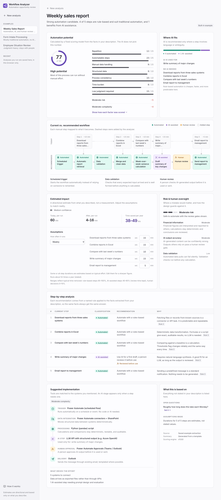
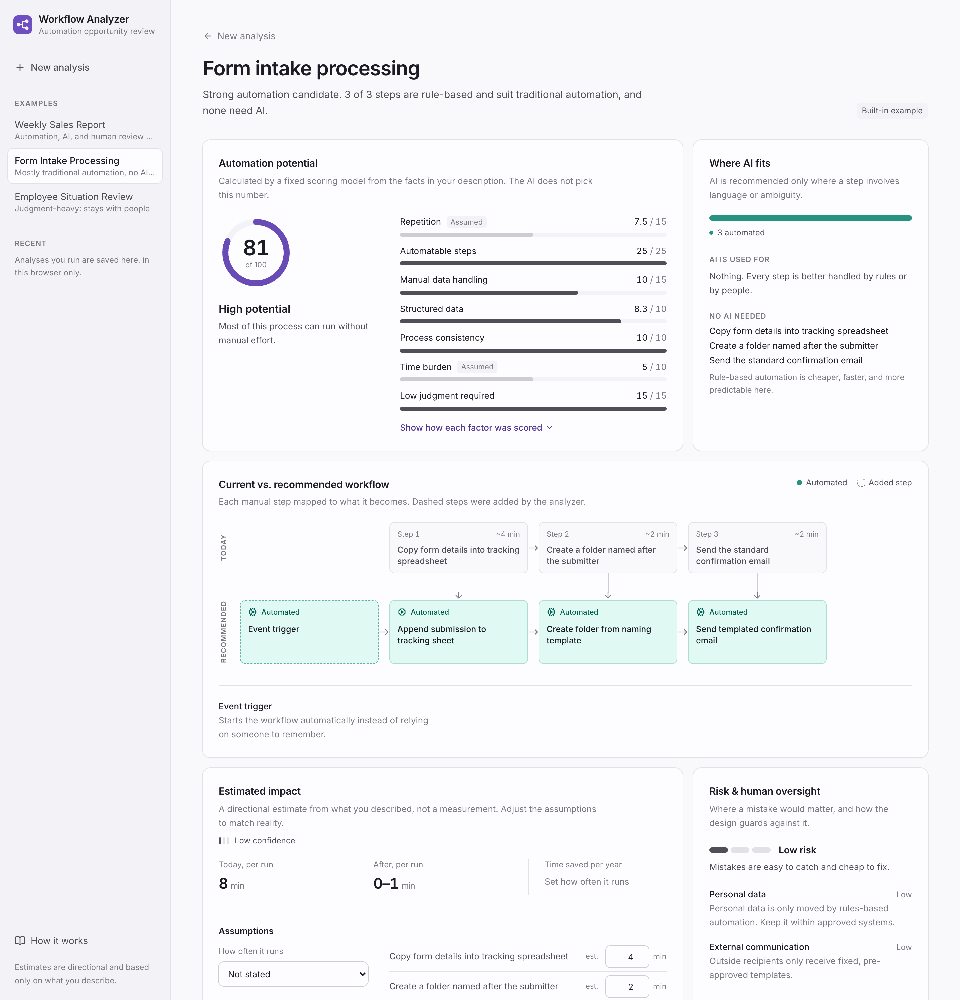
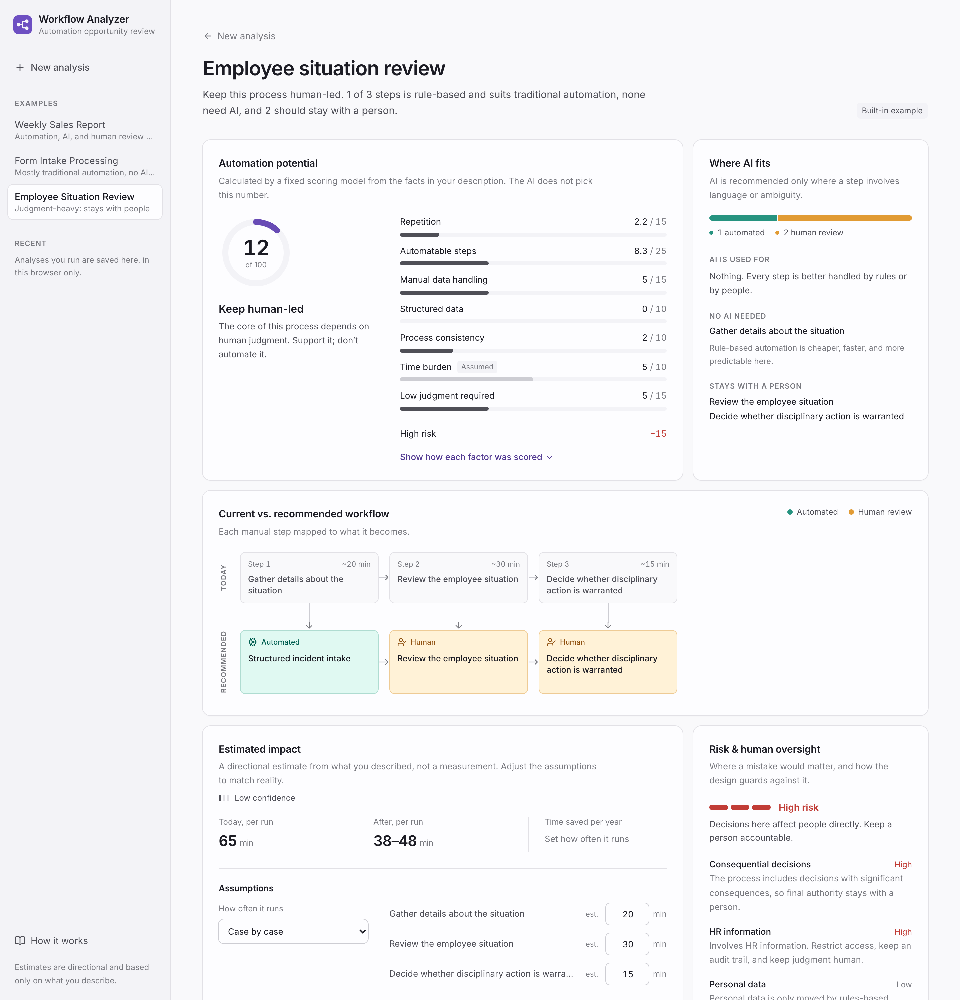
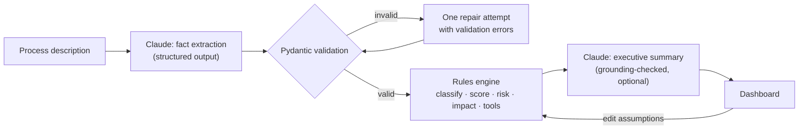
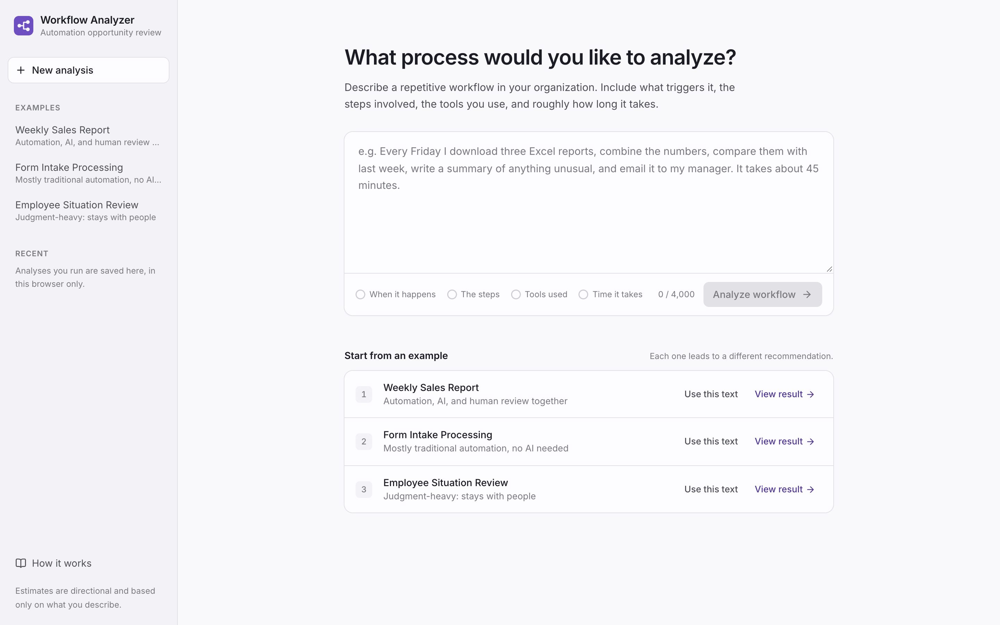
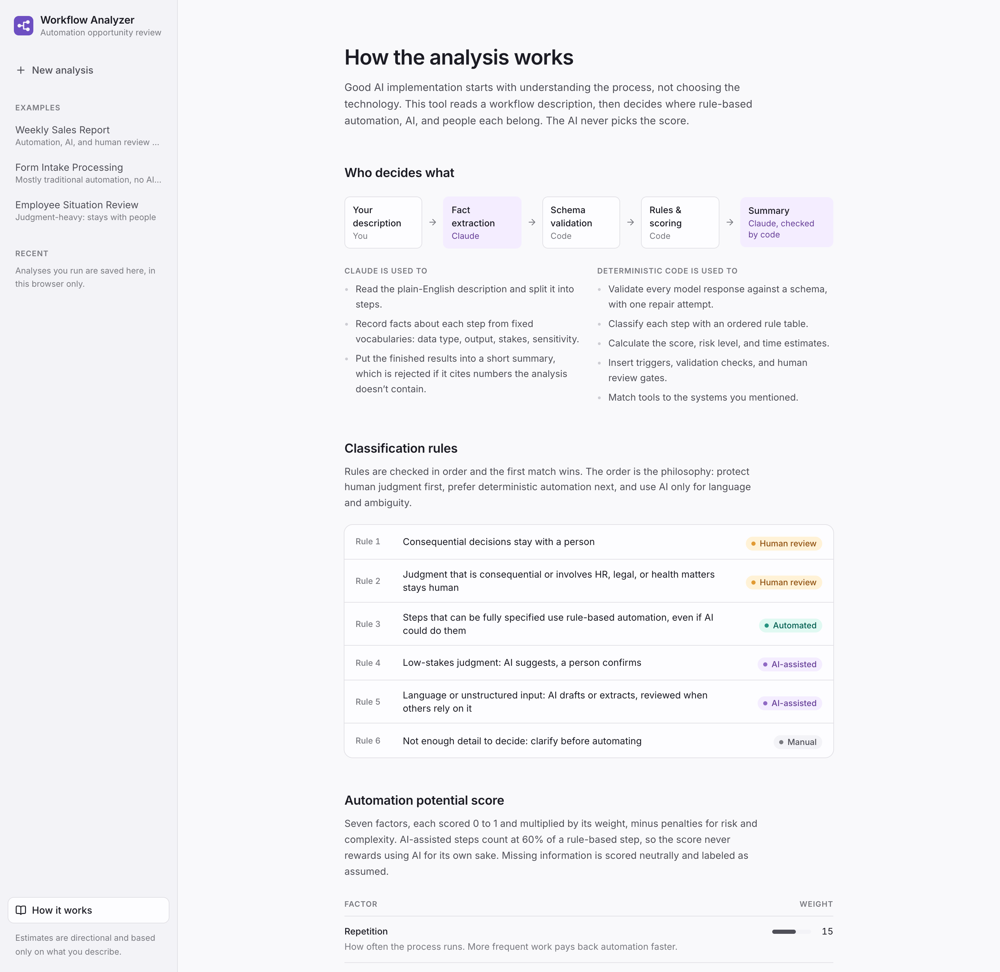

# AI Workflow Opportunity Analyzer

Describe a repetitive business process in plain English. The analyzer maps it step by step and shows where **traditional automation**, **AI**, and **human review** each belong, with a transparent score, directional time savings, risks, and a lightweight implementation plan.

The analyzer is built around one idea: **good AI implementation starts with understanding the process, not choosing the technology.**



---

## 1. The problem

Most teams don't lack AI tools. They lack a clear view of which parts of their work AI should touch. Two failure modes are common:

- **Automating with AI by default.** An LLM gets used to copy spreadsheet cells or send a fixed email: slower, costlier, and less reliable than a simple integration.
- **Automating judgment that should stay human.** Decisions about people, money, or compliance get delegated to a model because the demo looked good.

Before building anything, someone has to break the process into steps and decide, step by step, what kind of help each one needs. That analysis is usually done informally, if at all.

## 2. Why I built it

I'm interested in AI enablement: working with teams to understand how they actually work, finding the steps that waste their time, and building small, practical automations that help them.

When someone is hesitant about AI, I've found the best approach is to first understand *why* and to look closely at their process. The next step is a small demonstration that saves them even a few minutes, so they can see the benefit for themselves. This project packages the first half of that conversation into a tool: describe the process, then see exactly where automation helps, where AI is worth it, and where a person should stay in charge.

My other projects are larger systems (a bilingual AI assistant for small businesses, a personal multi-agent system, n8n scheduling automations). This one is intentionally small, focused on product thinking and responsible AI use rather than system size.

## 3. Product philosophy

The analyzer is designed to *not* recommend AI for everything.

| Prefer **traditional automation** for | Use **AI** for | Keep **human review** for |
|---|---|---|
| Moving, copying, renaming files | Understanding unstructured text | Consequential financial decisions |
| Calculations and comparisons | Summaries and natural-language drafts | Legal or HR conclusions |
| Database queries, structured data | Classifying ambiguous inputs | Sensitive external communication |
| Scheduled triggers | Extracting meaning from documents | Final approval of AI output |
| Predefined notifications | Contextual pattern explanation | Anything where accountability matters |

The three built-in examples show the three outcomes:

| Example | Score | Result |
|---|---|---|
| **Weekly sales report:** download three reports, combine, compare, summarize, email | 77, High | 4 rule-based steps, AI drafts **only** the summary, and a human review gate is inserted before sending |
| **Form intake:** copy a submission, create a folder, send the same confirmation | 81, High | **No AI at all.** Everything is deterministic |
| **Employee situation review:** decide whether disciplinary action is warranted | 12, Keep human-led | The review and the decision stay with a person; only intake is structured |

| Mostly traditional automation | Human judgment stays in charge |
|---|---|
|  |  |

## 4. Architecture



The LLM is used in exactly two places, and neither one makes a decision:

1. **Extraction** turns free text into facts about each step, chosen from closed vocabularies (action type, input data type, output nature, stakes, sensitivity, stated or inferred duration).
2. **Narrative** puts the engine's finished results into two or three sentences for a manager.

Everything in between is plain Python that can be tested, reproduced, and explained.

```
backend/
  app/
    schemas.py          Extraction (LLM contract) and Analysis (API contract)
    llm/extract.py      structured-output call, validation, repair retry, typed errors
    llm/narrative.py    summary from results + grounding check
    engine/classify.py  ordered rule table (R1–R6)
    engine/scoring.py   weighted factors, penalties, bands
    engine/impact.py    time ranges, frequency, confidence
    engine/risk.py      risk flags and implementation complexity
    engine/workflow.py  current → recommended workflow, inserted gates
    engine/architecture.py  tool catalog by ecosystem and capability
    engine/methodology.py   documentation generated from the constants above
    ratelimit.py        per-visitor and daily limits on live analyses
    main.py             FastAPI routes; also serves the built frontend
  tests/                golden examples + unit tests (no API key needed)
frontend/               React + TypeScript + Tailwind dashboard
```

## 5. Tech stack

| Layer | Choice | Why |
|---|---|---|
| API | Python, FastAPI, Pydantic v2 | Typed contracts at every boundary; validation is the safety layer |
| LLM | Claude via the Anthropic SDK, JSON-schema structured output | Output is constrained to the schema, then validated again |
| Engine | Plain Python | Deterministic, fast, unit-testable |
| Frontend | React, TypeScript, Vite, Tailwind CSS | Interactive dashboard with shared state (hover-linking, live recalculation) |
| Workflow diagram | Custom components | Purpose-built, with no diagram library |
| Storage | None (recent analyses in browser `localStorage`) | No accounts or database needed for the MVP |
| Deploy | Vercel (static frontend + FastAPI function, one project); Dockerfile for any container host | One URL, one deploy |
| CI | GitHub Actions: pytest, lint, production build | |

## 6. How workflow scoring works

**Automation Potential (0–100)** is the sum of seven weighted factors minus penalties. Each factor is scored 0–1 from the extracted facts:

| Factor | Weight | Measures |
|---|---:|---|
| Repetition | 15 | How often it runs (daily 1.0 → ad hoc 0.15) |
| Automatable steps | 25 | Share of rule-based steps; AI-assisted steps count at **60%** |
| Manual data handling | 15 | Share of steps that fetch, copy, or reshape data by hand |
| Structured data | 10 | How much input is tables or fields vs. free text |
| Process consistency | 10 | Same every time vs. case by case |
| Time burden | 10 | Manual hours per year |
| Low judgment required | 15 | Share of steps that don't depend on discretion |

**Penalties:** high risk −15, moderate risk −5; high complexity −10, moderate −4.
**Bands:** 75+ High · 50–74 Moderate · 25–49 Limited · under 25 Keep human-led.

Design choices worth noting:

- **The score does not reward AI.** A fully deterministic process can score in the 90s with no LLM, and a test verifies that an AI-heavy process scores *lower* than its deterministic twin.
- **Missing facts are scored neutrally and labeled "Assumed"** instead of being guessed.
- **Every number is explainable.** The UI shows each factor's points and the reasoning behind it, and the in-app *How it works* page is generated from the same constants the engine runs on, so the documentation can't drift from the code.

## 7. How AI is used

- **Structured output, not free text.** The extraction schema is generated from the Pydantic model, so the LLM response and the validation code share one definition.
- **Two validation layers.** The API constrains the output to the JSON schema; Pydantic then enforces rules a schema can't express (at least two steps, unique ids, consistent sources).
- **One repair attempt.** If validation fails, the specific errors are sent back once. If it fails again, the user sees a clear error, never a half-built analysis.
- **Typed failures.** Missing credentials, rate limits, outages, refusals, and invalid output each map to a specific HTTP status and a plain-language message.
- **The user's description is treated as data.** It's wrapped in tags, the prompt instructs the model to ignore embedded instructions, and the only thing it can produce is schema-shaped facts.
- **A grounded summary.** The narrative model receives the *results*, not the original text. Its output is rejected if it cites numbers the analysis doesn't contain or mentions time savings (which are editable estimates and would go stale). On rejection, the template summary is kept.
- **Versioned prompts.** Every response reports its prompt and engine versions.

## 8. Why deterministic automation is intentionally preferred

The classification rules run in order and the first match wins:

| Rule | Condition | Outcome |
|---|---|---|
| R1 | Consequential decision | Human review |
| R2 | Judgment that is consequential or involves HR, legal, or health | Human review |
| R3 | Output can be fully specified as rules or a template | **Traditional automation**, even if AI could do it |
| R4 | Low-stakes judgment | AI suggests, person confirms |
| R5 | Language or unstructured input | AI drafts or extracts, reviewed when others rely on it |
| R6 | Not enough detail | Clarify before automating |

Rule 3 comes before rules 4 and 5 on purpose. When a step can be written as a formula, a mapping, or a template, rules are cheaper, faster, auditable, and never hallucinate. AI is reserved for steps that genuinely involve language or ambiguity. The dashboard makes this explicit with a **"No AI needed"** list for every analysis.

## 9. Human-in-the-loop design

- **Decisions stay human.** R1 and R2 protect judgment that affects people, money, or legal standing. The engine never "automates" these; it only suggests structuring their inputs.
- **Review gates are inserted automatically.** When AI-generated content will be sent or relied on by others, the recommended workflow adds a *Human review* step before it goes out.
- **Risk is reported separately from the score:** sensitive data, financial interpretation, external communication, AI accuracy, and data validation, each with a reason.
- **Estimates are honest.** Time savings are ranges with a confidence level; inferred values are marked; yearly totals are withheld until the frequency is known. Users can correct every assumption, and the recalculation happens in code, with no extra AI call.

## 10. Screenshots and demo

| Describe the process | How the analysis works |
|---|---|
|  |  |

Each example has a shareable link, which is handy for a portfolio or a demo:

- `/#/examples/weekly_sales_report`
- `/#/examples/intake_form`
- `/#/examples/employee_review`
- `/#/how-it-works`

Built-in examples run from saved extractions, so they load instantly and work without an API key. To regenerate the screenshots against a running app: `node scripts/capture-screenshots.mjs http://localhost:8000` (requires Chrome).

## 11. Local setup

**Requirements:** Python 3.11+, Node 20+, and an [Anthropic API key](https://console.anthropic.com/) for live analysis (the examples work without one).

```bash
# Backend
cd backend
python3 -m venv .venv
.venv/bin/pip install -r requirements-dev.txt
cp .env.example .env            # add ANTHROPIC_API_KEY
.venv/bin/uvicorn app.main:app --reload    # http://localhost:8000

# Frontend (second terminal)
cd frontend
npm install
npm run dev                      # http://localhost:5173 (proxies /api to :8000)

# Tests
cd backend && .venv/bin/pytest
```

**Configuration** (environment variables):

| Variable | Default | Purpose |
|---|---|---|
| `ANTHROPIC_API_KEY` | none | Required for live analyses |
| `ANTHROPIC_MODEL` | `claude-opus-5-5` | Model for extraction and summary |
| `ANTHROPIC_EFFORT` | `medium` | Reasoning effort for extraction |
| `RATE_LIMIT_PER_HOUR` | `10` | Live analyses per visitor per hour |
| `DAILY_ANALYSIS_LIMIT` | `200` | Live analyses per day across all visitors |

**Deploy on Vercel:** `vercel.json` defines two services in one project: `frontend/` (static Vite build) and `backend/` (FastAPI function), with `/api/*` routed to the backend. Import the GitHub repo in Vercel and set `ANTHROPIC_API_KEY` under Environment Variables.

**Deploy anywhere else:** the root `Dockerfile` builds the frontend and serves it from FastAPI as a single container (`render.yaml` is included for Render).

Rate limits are kept in memory per server instance, so on serverless hosts they are a soft guard. Set a monthly spend limit in the Anthropic Console as the hard cap.

## 12. Future improvements

- **Evaluation set for the extraction prompt:** a labeled collection of process descriptions to measure classification agreement as the prompt changes.
- **Side-by-side comparison** of several processes to prioritize which to automate first.
- **Export** of the analysis as a one-page brief (PDF or Markdown) for stakeholders.
- **Follow-up questions in place:** answer open questions inline and re-run extraction with the added detail.
- **Shareable results** for live analyses (would need a small datastore, such as Supabase).
- **Build-effort estimate** next to time savings, for a rough payback period.

---

Built by Heidy Veliz.
